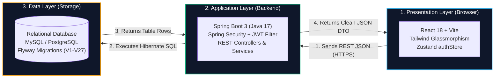
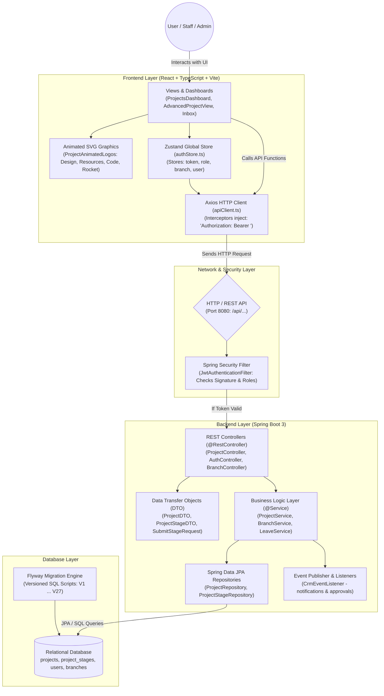
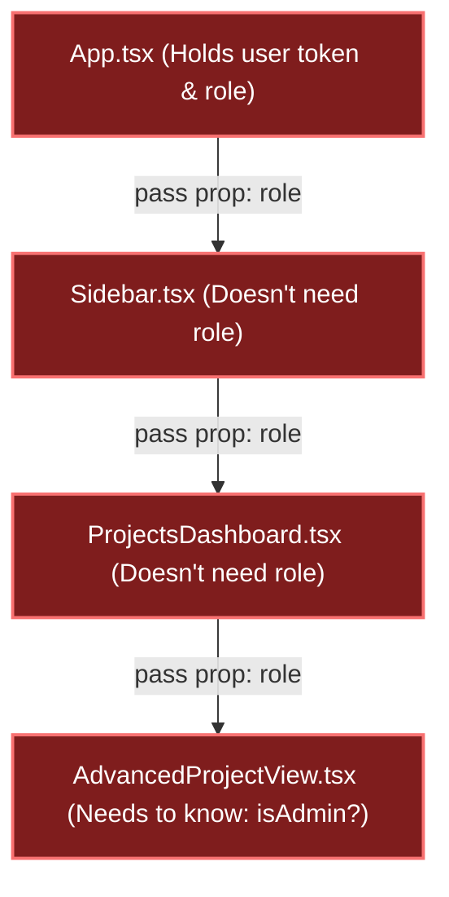
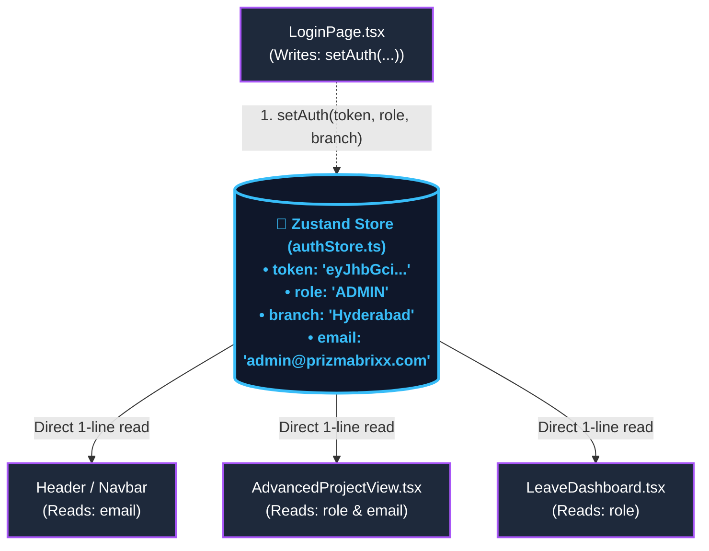
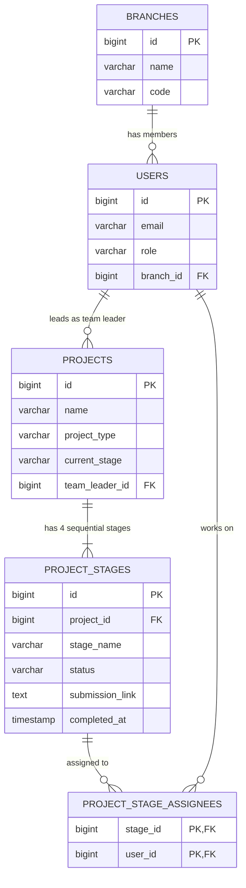

# Prizma CRM - System Architecture & Technical Design

Welcome to the **Prizma CRM** architecture documentation. This document explains the high-level architecture, module breakdown, request lifecycles, and data flows in simple, clear terms with visual diagrams.

---

## Table of Contents
1. [The Big Picture (3-Tier Architecture)](#1-the-big-picture-3-tier-architecture)
2. [Full System Architecture Diagram](#2-full-system-architecture-diagram)
3. [Global State Management with Zustand](#3-global-state-management-with-zustand)
4. [Life of a Request (Step-by-Step Sequence)](#4-life-of-a-request-step-by-step-sequence)
5. [Core Functional Modules](#5-core-functional-modules)
6. [Database Schema & Flyway Migrations](#6-database-schema--flyway-migrations)
7. [Running Locally](#7-running-locally)

---

## 1. The Big Picture (3-Tier Architecture)

Prizma CRM follows a modern **3-Tier Architecture** pattern. Think of it like a **restaurant**:

| Tier | Component | Real-World Metaphor | What it Does |
| :--- | :--- | :--- | :--- |
| **Presentation Tier** | **Frontend (React 18 + Vite)** | *The Dining Room & Waiter* | What staff and admins see on screen: buttons, cards, animated stage progress, and forms. |
| **Application Tier** | **Backend (Spring Boot 3)** | *The Kitchen & Head Chef* | Receives requests, checks security passports (JWT), verifies permissions, and executes business logic. |
| **Data Tier** | **Database (MySQL / PostgreSQL)** | *The Pantry & Storage Room* | Stores all persistent records safely: employees, projects, stages, branches, leaves, and invoices. |



---

## 2. Full System Architecture Diagram

This diagram shows how all layers and components communicate with each other:



---

## 3. Global State Management with Zustand

### What is Zustand?
Zustand is a minimal, blazing-fast **global state management library** for React. It holds shared application data in a central "whiteboard" in memory.

### The Problem: Prop Drilling (Without Zustand)
Without a global store, sharing user data requires passing props through multiple intermediary components:



### The Solution: Direct Access with Zustand
Any component across the entire app can read or write to `authStore` with a single line:



### Concrete Code Examples from this Repository

**Store Definition (`frontend/src/store/authStore.ts`)**:
```typescript
import { create } from 'zustand';

export const useAuthStore = create((set) => ({
  token: null,
  email: null,
  role: null,
  branchName: null,
  setAuth: (token, email, role, departmentName, branchName, branchId) =>
    set({ token, email, role, departmentName, branchName, branchId }),
  logout: () =>
    set({ token: null, email: null, role: null, departmentName: null, branchName: null, branchId: null }),
}));
```

**Writing to Store on Login (`frontend/src/features/auth/authApi.ts`)**:
```typescript
useAuthStore.getState().setAuth(token, email, role, departmentName, branchName, branchId);
```

**Reading in Any Component (`frontend/src/features/projects/AdvancedProjectView.tsx`)**:
```typescript
const { role, email: userEmail } = useAuthStore();
const isAdmin = role === 'ADMIN' || role === 'SYSTEM_MASTER';
```

---

## 4. Life of a Request (Step-by-Step Sequence)

Here is the exact journey of a request when an Admin or Team Lead clicks **"Mark as Complete"** on the **Design** stage of an Advanced Project:

```mermaid
sequenceDiagram
    autonumber
    actor User as Admin / Team Leader
    participant UI as AdvancedProjectView (React)
    participant Axios as apiClient (Axios)
    participant Security as JwtAuthenticationFilter
    participant Controller as ProjectController
    participant Service as ProjectService
    participant DB as Database (JPA / MySQL)

    User->>UI: Clicks "Mark as Complete" on Design Stage
    UI->>Axios: completeStage(projectId=1, stageName="DESIGN")
    Note over Axios: Attaches Header:<br/>Authorization: Bearer <JWT_TOKEN>
    Axios->>Security: POST /api/projects/1/stages/DESIGN/complete
    Security->>Security: Decodes & verifies JWT signature & user permissions
    Security->>Controller: Routes to @PostMapping endpoint
    Controller->>Service: projectService.completeStage(1, "DESIGN")
    
    rect rgb(20, 30, 45)
        Note over Service: Business Logic Execution:<br/>1. Mark current stage: status = 'COMPLETED'<br/>2. Set completedAt timestamp = now()<br/>3. Advance project.currentStage = 'RESOURCES'<br/>4. Mark next stage: status = 'IN_PROGRESS'
    end

    Service->>DB: UPDATE project_stages SET status='COMPLETED' WHERE id=1
    Service->>DB: UPDATE project_stages SET status='IN_PROGRESS' WHERE id=2
    Service->>DB: UPDATE projects SET current_stage='RESOURCES' WHERE id=1
    DB-->>Service: Rows updated successfully
    Service-->>Controller: Returns updated ProjectStageDTO
    Controller-->>Axios: 200 OK + Updated Stage JSON
    Axios-->>UI: Promise resolves with updated data
    UI->>UI: Framer Motion animates connecting line and advances glowing node to Stage 2
    UI-->>User: Screen shows Stage 1 (Done ✓) and Stage 2 (Active ⊙)
```



---

## 5. Core Functional Modules

### 1. Multi-Branch System
- **Purpose**: Allows the CRM to operate across physical office branches (e.g., `Hyderabad`, `Bangalore`, `Pune`).
- **Features**:
  - Admins can add or rename branches.
  - Employees are assigned to a branch during onboarding.
  - Branch dropdown on the login page scopes the user session.
  - Entity: `Branch.java` | Service: `BranchService.java` | Controller: `BranchController.java`.

### 2. Advanced Project Pipeline
- **Purpose**: Provides a structured 4-stage sequential engineering workflow.
- **Workflow**:
  - **Stage 1: Design**: UI/UX mockups, wireframes, style guide links.
  - **Stage 2: Resources**: Schemas, API keys, assets, cloud credentials.
  - **Stage 3: Develop & Test**: Feature development, test suites, integration tests.
  - **Stage 4: Deploy**: Staging validation, CI/CD rollout, smoke tests.
- **Key Capabilities**:
  - Designated **Team Leader** selector at project creation.
  - Admins can assign 1 or more employees from **any department** per stage.
  - Employees submit deliverables as Google Drive, GitHub, or Figma links.
  - Clicking **"Mark as Complete"** advances the circular stepper and fills the connecting progress line.

### 3. Work Inbox & Approvals Drawer
- **Purpose**: Centralized notification and action hub for managers and admins.
- **Features**: Slide-over drawer to approve or reject Leave requests, Expense claims, and Asset requisitions.

### 4. Attendance & Leaves
- **Purpose**: Daily clock-in / clock-out tracking, leave balance calculation, and manager approvals.

### 5. Sales & Finance
- **Purpose**: Leads pipeline, client contacts, invoice generation, and revenue reporting.

---

## 6. Database Schema & Flyway Migrations

The database is version-controlled using **Flyway**. When the backend starts up, Flyway scans `backend/src/main/resources/db/migration/` and automatically applies any new SQL scripts in sequence.



---

## 7. Running Locally

### Prerequisites
- Node.js 20+ and npm
- Java 17+ and Maven
- MySQL or PostgreSQL database running locally

### Start the Backend Server (Port 8080)
```powershell
cd backend
mvn spring-boot:run
```

### Start the Frontend Dev Server (Port 5173)
```powershell
cd frontend
npm install
npm run dev
```

Open your browser at: `http://localhost:5173`
- Default Admin: `admin@prizmabrixx.com` / `admin123`
- Default Employee: `jane.doe@prizmabrixx.com` / `password123`
